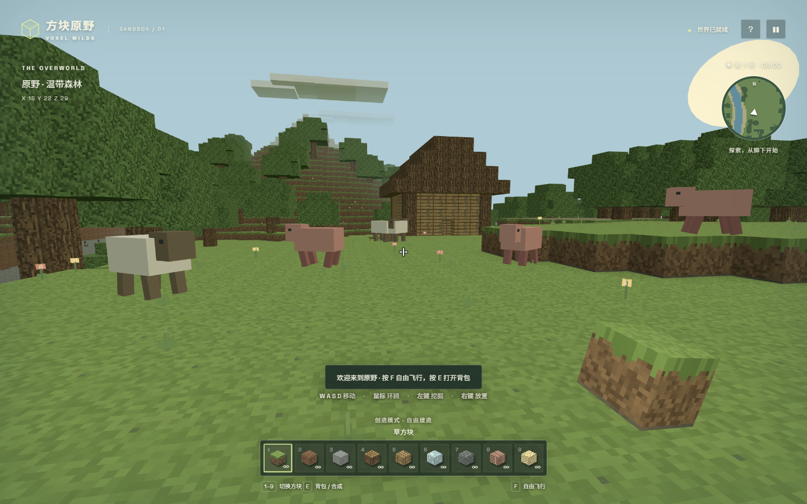
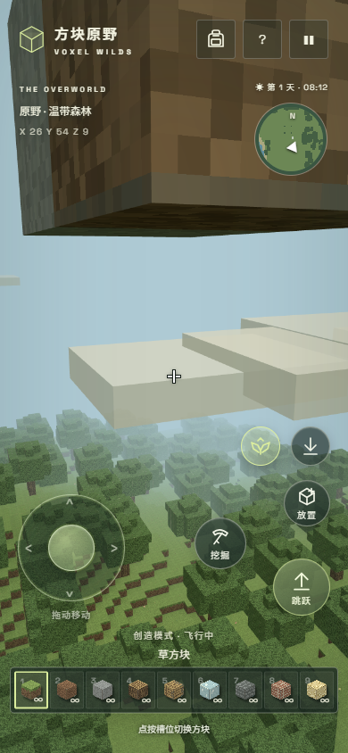
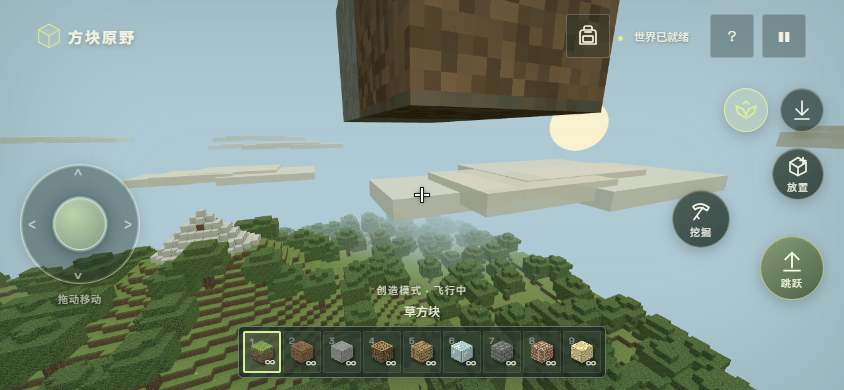

# 方块原野 · VOXEL WILDS

原创浏览器体素沙盒，以 Minecraft 的自由探索与建造体验为灵感。使用原创程序化像素材质，不含官方素材。

[在线游玩](https://voxel-wilds-heyon-1030.y93037490.chatgpt.site/)

- 160 × 160 × 64 方块世界，固定种子生成山地、河流、树林、矿石、地下空隙与可进入的小屋；出生点留出无遮挡的林间空地。
- 第一人称碰撞、跳跃、奔跑、游泳；创造模式飞行与无限方块；可选"自动跳跃"（撞到一格高的坎自动起跳，默认触屏开启、键鼠关闭）。
- 持续挖掘、放置、九格快捷栏、背包（可直接点选要替换的槽位）、材料合成、工具升级。
- 简化生存模式：生命、饱食度、摔落伤害、苹果恢复、保留物品的重生。
- 昼夜、天空、云层、动物漫游、方块碎屑、合成音效、实时小地图（随建造与挖掘更新）。
- 浏览器本地自动存档、手动保存、JSON 导入导出、新世界种子；视野 / 灵敏度 / 音效 / 昼夜 / 自动跳跃会单独记住。
- 键鼠与触屏控制（模拟摇杆、挖掘 / 放置 / 跳跃 / 飞行 / 下降）。浏览器禁止鼠标锁定时可按住画面拖动环顾，使用 Q 挖掘、G 放置，拖动不会误挖方块。

这是有限地图的单人沙盒原型，尚未实现联机、红石电路、敌对生物、流体传播或完整 Minecraft 合成规则。

## 本地运行

需要 Node.js 22.4 或以上版本，无需安装 npm 依赖。

1. 在此文件夹中双击 `启动游戏.cmd`，脚本会自动启动本地服务并用默认浏览器打开游戏。
2. 游戏期间保持命令行窗口打开；关闭此窗口即可停止服务。重复双击会复用已运行的游戏服务。
3. 本地地址为 `http://127.0.0.1:4178`。本地版与线上版的浏览器存档分别保存，可在游戏设置中导出、导入迁移。

也可在终端执行 `node launch.mjs`。

`npm test` 运行确定性地形、存档修改、地表高度、射线选取与摇杆方向/速度验证。

渲染库 Three.js 位于 dist/vendor，保留 MIT 许可证。游戏渲染不依赖外部 CDN。

## 操作

- 键鼠：WASD 移动、空格跳跃、Shift 奔跑、左键挖掘、右键放置、1–9 切换、E 背包、F 飞行、R 吃苹果、Esc 暂停。
- 触屏：左侧摇杆移动（轻推慢走、推满快走、支持斜向，松手停止），右侧圆形图标键挖掘 / 放置 / 跳跃，上方双翼图标切换飞行、向下箭头下降，顶栏背包图标打开背包；拖动空白画面转视角。六个动作都可在摇杆按住时用另一根手指触发。
- 嵌入页面无法锁定鼠标时：按住画面拖动即可环顾，长按 Q 挖掘、按 G 放置。

## 开发与测试

- 在项目文件夹打开终端，运行 `npm start`，浏览器访问 `http://127.0.0.1:4178`。该方式可用于 Windows、macOS 和 Linux。
- 运行 `npm test`，执行 8 项单元测试。
- Windows Chrome 浏览器验收：保持 `npm start` 服务运行，另开终端执行 `node tests/acceptance.cdp.mjs` 或 `node tests/joystick.cdp.mjs`。连接代码已包含在 `tests/support/`，无需外部工作区或浏览器自动化依赖。
- 浏览器验收使用 localhost 来源并恢复测试前的存储；会启动或复用 9222 调试端口的 Chrome，结束后保留浏览器。临时截图生成在忽略的 `audit-shots/` 目录。

## 手机界面

修复过程及历史验收结论保留在根目录各份中文报告中。最新源码的静态资源位于 `dist/`；`.openai/hosting.json` 保留现有 Sites 站点绑定，不包含凭据。
