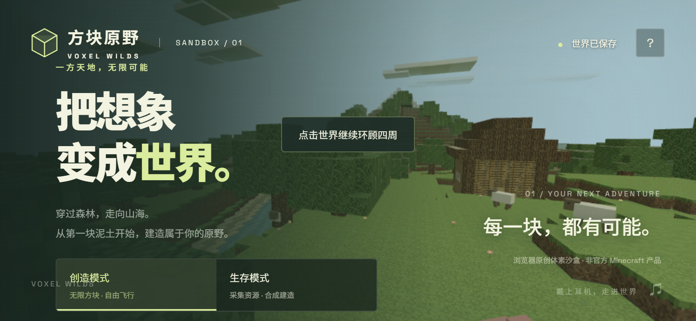
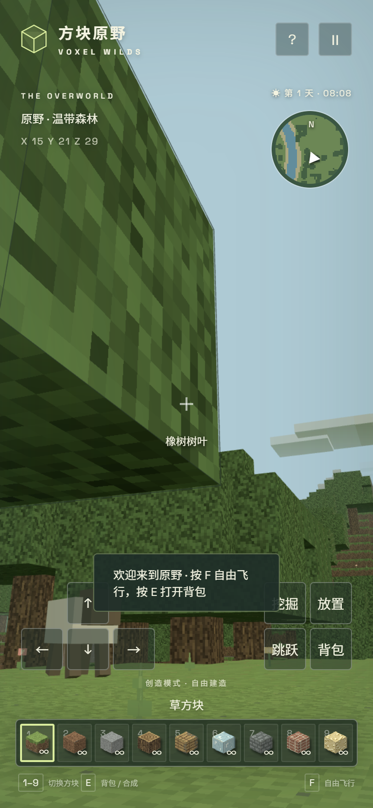
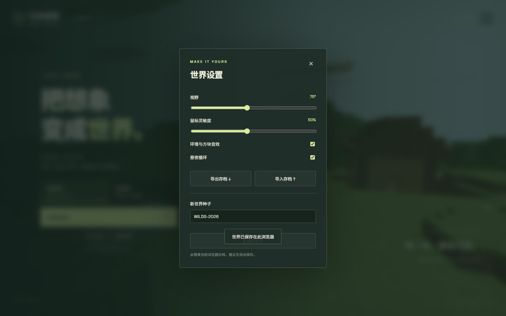
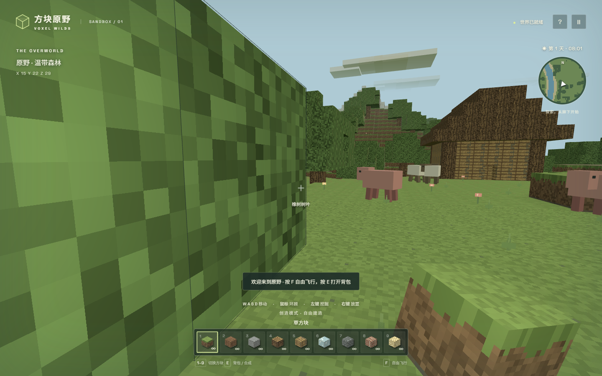
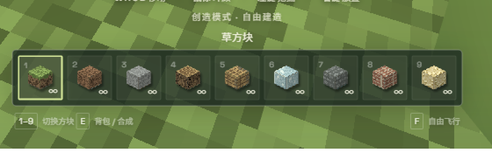
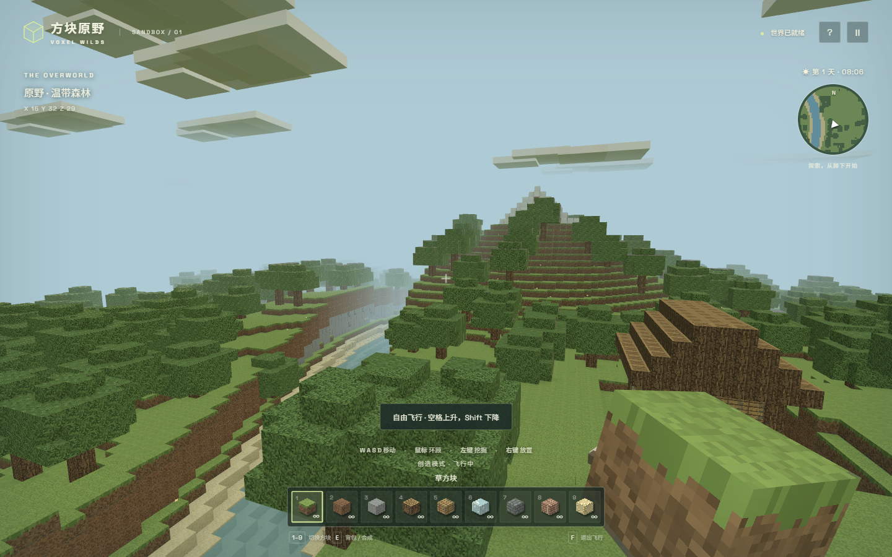
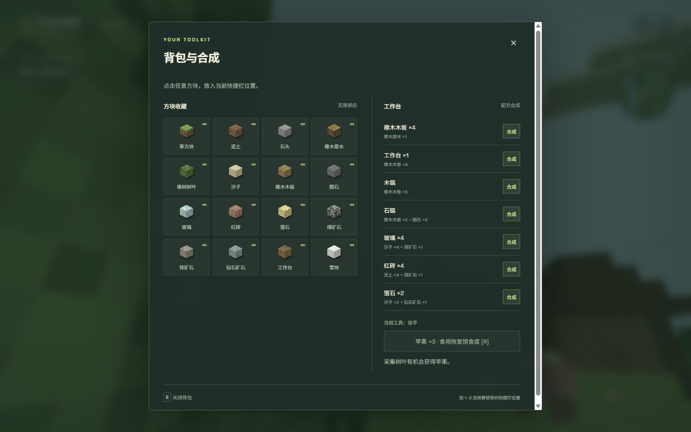
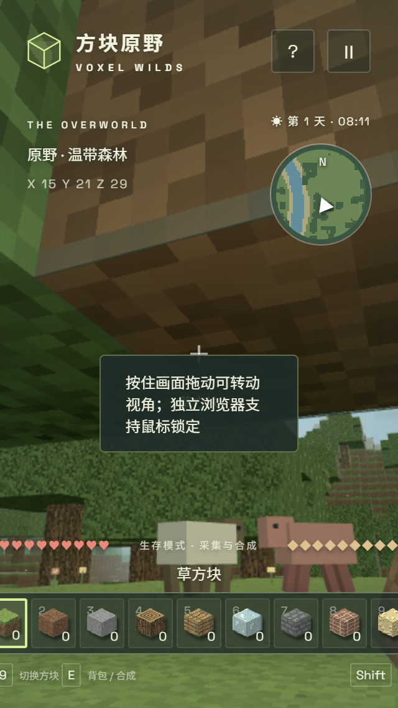
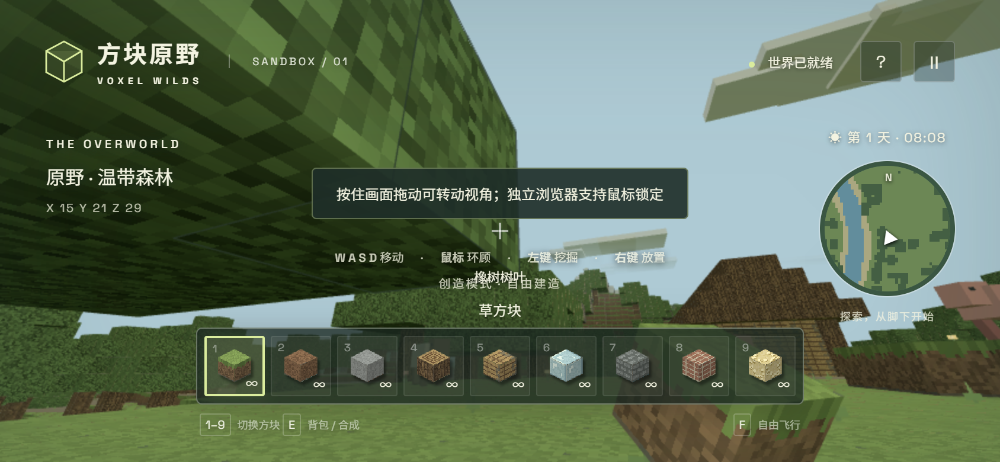
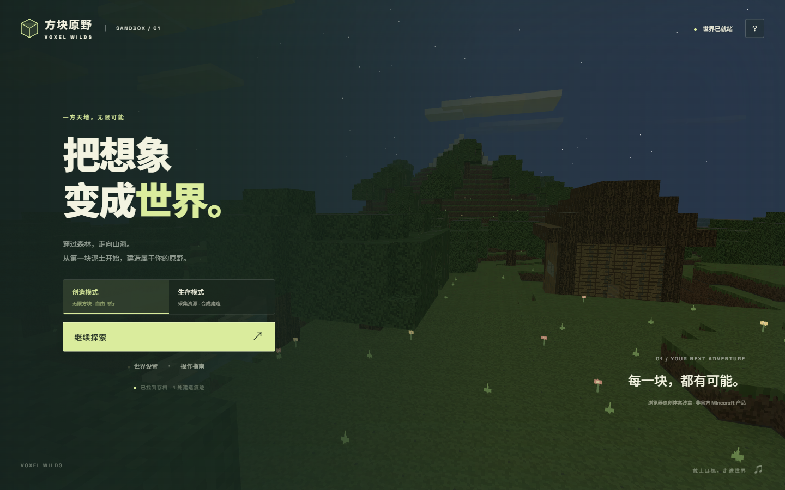

# 方块原野 · VOXEL WILDS —— 全面体验与缺陷评估

> **注：本文件是修复前的评估快照。** 文中列出的 P0/P1/P2 问题已在 [修复说明.md](修复说明.md) 中逐项修复并回归验证；修复后的截图见 `audit-shots/after-*.png`。

> 评估对象：`sites/voxel-wilds-20261030`（commit 70912cc + 未提交的 launcher）
> 评估方式：**通读全部源码**（index.html / style.css / game.js / render.js / world.js / serve.mjs / launch.mjs / 测试）+ **Chromium 156 实测截图与 DOM 度量**（1440×900、1024×600、844×390、390×844、320×568，含触屏仿真）
> 说明：文中 **[实测]** 表示我用浏览器复现并截图/取数验证过；**[代码推断]** 表示从源码可直接确定、但未单独构造场景复现。

---

## 一、总体结论（先给答案）

**这是一个完成度相当高的桌面浏览器单机体素沙盒原型：美术方向、HUD 信息架构、地形/渲染/采矿/合成/存档的闭环都在水准线以上，桌面 Chrome 上能获得 60fps、23 万三角形的流畅体验。但它现在还不能直接对外推广：移动端（尤其横屏）有一条"根本进不去"的阻断级路径，存档的"导入 / 新世界"在游戏内使用时会静默失效，设置项完全不持久化。这三件事任意一条都足以让真实用户判定"这游戏坏了"。**

| 维度 | 评价 | 依据 |
|---|---|---|
| 视觉/美术 | ★★★★☆ 8.5 | 原创像素材质、配色克制、菜单排版有设计感；手持方块比例失调、树叶噪点过重 |
| 信息架构 | ★★★★ 7.5 | 菜单/HUD/背包/设置分区清楚；设置入口藏在暂停里、模式切换要先回首页 |
| 桌面端可玩性 | ★★★★ 7.5 | 挖掘/放置/合成/存档闭环完整；**没有自动上台阶**，走一格就要跳一次 |
| 移动端适配 | ★★ 3 | 横屏进不去；无飞行/冲刺；背包无法选槽位；HUD 溢出；触控目标偏小 |
| 存档可靠性 | ★★ 2.5 | **导入/新世界被自动保存覆盖**；设置不持久；存储失败静默 |
| 代码质量 | ★★★☆ 6.5 | 结构清晰、有 DDA 射线与确定性测试；但单文件巨石、无错误边界、QA 脚本不可移植 |
| 可访问性 | ★★ 4 | 有 aria-label/focus-visible/role=status 的基础；但模态无语义/无焦点陷阱、9px 文本、35px 按钮 |
| 内容完成度 | ★★★ 6 | 20 种方块、7 个配方、12 只动物、1 间小屋；README 部分描述与实现不符 |

**最该先修的 5 件事**：横屏菜单 → 存档覆盖 → 设置持久化 → 自动上台阶 → 手持方块比例/准星可见性。

---

## 二、阻断级问题（P0）

### P0-1 横屏手机（以及任何高度 < ~470px 的窗口）**无法开始游戏** [实测]

在 844×390 的横屏手机上，主菜单的「进入原野」按钮整体落在视口之外：

```
#play 矩形        : y 392.5 → bottom 446.5
视口高度           : 390
#menu scrollHeight : 512   （有 122px 内容溢出）
#menu overflow-y   : visible
body overflow-y    : hidden
documentElement    : scrollHeight 390 === clientHeight 390   ← 没有任何滚动可能
```

`#menu` 是 `position:fixed;inset:0`，内容绝对定位 `top:19%`，`body{overflow:hidden}`，所以溢出的部分既看不到也滚不到。用户能看见模式选择器，但**永远点不到开始按钮**。点击测试确认 `playReachable:false`，点击后仍停留在菜单。

同一根因还导致：
- **1024×600** 窗口：菜单内容底边 `551px` 与页脚 `549px` 重叠；[实测]
- **320×568**：页脚「VOXEL WILDS」压在「世界设置 · 操作指南」上；[实测]
- 任何把窗口拉矮到 500px 左右的桌面用户，同样会失去开始按钮。

> 位置：`dist/style.css:2`（`.menu-content{position:absolute;top:23%…}`、`body{overflow:hidden}`）、`dist/style.css:3`（`@media(max-height:760px)` 只调了 top/字号，没有解决溢出）。

**建议**：把菜单改成"可在 `#menu` 内滚动"的 flex 布局（`.screen{overflow-y:auto}` + `margin:auto`），或至少加 `@media(max-height:520px)` 的紧凑布局（隐藏 intro/scene-caption、缩小标题、减间距）。这是上线前必须清零的问题。



---

### P0-2 游戏内「生成新世界 / 导入存档」**静默失效**（被自动保存覆盖） [实测]

这是本次评估最严重的功能性缺陷，且**没有任何报错**，用户只会觉得"种子没用"。

复现：进入游戏 → 暂停 → 世界设置 → 输入新种子 `NEWSEED-TEST` → 生成新世界 → 页面刷新后：

```
BEFORE  seed = WILDS-2026
AFTER   seed = WILDS-2026     ← 期望 NEWSEED-TEST
```

导入存档同样：

```
导入 seed=IMPORT-TEST-42 → 刷新后 seed 仍为 WILDS-2026
```

**原因链**（`dist/game.js`）：

1. `new-world` / `import-file` 先把新存档写入 `localStorage`，再 `location.reload()`（第 57、58 行）；
2. 页面卸载时触发 `beforeunload`，执行 `if(started) saveWorld()`（第 66 行）；
3. `started` 在游戏内一直是 `true`（只有点「返回首页」才置 false），于是 `saveWorld()` 用**当前旧世界**把刚写入的新存档覆盖掉。

从首页（`started=false`）操作则一切正常——实测「导入」与「生成新世界」都成功，这反过来证明了上述原因链。

> 这意味着：用户最常用的入口（暂停 → 设置）恰好是坏的；只有"先退回首页再操作"这个未被说明的路径可用。

**建议**：加载/导入/新世界前显式 `started=false` 并设置 `suppressUnloadSave` 标志，或在 `beforeunload` 里检查一个"正在切换世界"的旗标；更稳妥的是把 `beforeunload` 只挂在 `pagehide` 且用一个 `dirty` 标志，而不是无条件写盘。顺带在 `#new-world` 的 `confirm` 之后加一个可见的"生成中…"状态（当前同步生成世界会先卡 0.2–1s 再弹确认框）。

---

### P0-3 设置项完全**不持久化** [实测]

在设置里把视野改成 100°、灵敏度 10%、关掉音效与昼夜循环，刷新后：

```
fov 100 → 75        sensitivity 10% → 50%
sound false → true  daycycle false → true
```

`saveObject()`（第 13 行）只保存 `version/seed/edits/player/yaw/pitch/mode/hotbar/inventory/tool/health/hunger/food/time/day`，**没有 fov / sensitivity / sound / cycle**；它们也不在 `localStorage` 的其它键里。玩家每局都要重调，属于典型的"看起来能调、其实不记住"。

**建议**：单独用 `voxel-wilds-settings` 键存 `{fov,sensitivity,sound,cycle}`，`init()` 时读取并同步滑块/复选框状态。

---

### P0-4 浏览器存储失败时**静默丢档** [代码推断 + 实测行为]

`saveWorld()`（第 14 行）的 catch 只把顶栏文字改成「存储不可用」，并在**手动保存**时才弹 toast；15 秒一次的自动保存失败没有任何可注意到的提示：

```js
catch{saveAvailable=false;$('save-status').textContent='存储不可用';
      if(manual)toast('浏览器存储不可用，请在世界设置中导出存档');}
```

而 `saveAvailable` 这个变量**在别处从未被读取**（死代码）。一旦存档体积接近 localStorage 配额（`edits` 是无上限增长的 Map，理论上可到 160×160×64 条），或用户开了隐私模式，游玩过程会持续丢档且无人知晓。顶栏那行字在移动端还是 `display:none`。

**建议**：自动保存失败 → 常驻横幅 + 一次性 toast + 建议导出；对 `edits` 做体积预警（例如 > 2 万条时提示），并考虑增量/压缩存储。

---

## 三、功能性缺陷（P1）

### P1-1 没有"自动上台阶"，每走一格都要跳 [实测]

`move()`（第 29–32 行）在水平碰撞时直接回退坐标，没有任何 step-up 逻辑（`collide()` 第 26 行只看当前脚部高度）。实测从出生点向前走：**0.9 秒只前进了 0.28 格就停住**，因为正前方是一格高的草方块；不跳就过不去。

这在体素地形里是致命的体验问题：整张地图都是阶梯状（山体、河岸、台地），玩家会变成"一路跳着走"。它是本次评估中**对操作手感影响最大的单点**。

**建议**：在水平轴碰撞回退前尝试"抬高 ≤0.6 格再移动"（Minecraft 的 step height 思路），或至少放宽到 0.55 并判断头顶空间。

> 附带：`shift` 只识别 `ShiftLeft`（右 Shift 不能跑/下降）；`walk`/`swing` 的衰减用 `*=.93`/`*=.8`（第 32、44 行）是**按帧**而非按 dt，144Hz 与 30Hz 下摆臂/步伐速度不一致。

---

### P1-2 触屏用户**没有飞行、没有冲刺**，但 HUD 仍在提示键盘操作 [实测]

- `#mobile-controls`（`index.html:16`）只有 `WASD / Space / 挖掘 / 放置 / 背包`，**没有 F（飞行）、没有 Shift（下降/冲刺）**。而默认模式恰恰是"创造模式 · 自由飞行"。
- 触屏下底栏仍显示 `1–9 切换方块  E 背包/合成` 与 `F 自由飞行`（`.hud-caption`、`#flight-hint`），这些键在手机上不存在；`#hint` 在 ≤760px 与 `pointer:coarse` 下都会隐藏，但 `hud-caption` 没有做任何触屏替换，于是手机上唯一剩下的操作提示全是键盘键位。

**建议**：`@media(pointer:coarse)` 下把 caption 换成触屏文案；补一个"飞行"切换按钮和"下降"按钮（长按 Shift 等价物）；或干脆在触屏下默认不进入飞行。



---

### P1-3 触屏背包**无法选择要替换的快捷栏位置** [实测 + 代码]

背包弹窗会盖住 hotbar；而"选槽位"的唯一方式是键盘 `1–9`（`game.js:59`）。在 ≤760px 下 `.panel-foot span{display:none}` 把"按 1–9 选择要替换的快捷栏位置"这句提示也隐藏了。结果是手机用户只能替换"打开背包前碰巧选中的那一格"，且没有任何可见的槽位高亮。

**建议**：背包内嵌一排 9 槽选择器（或直接把当前选中的槽位做高亮 + 可点击切换）。

---

### P1-4 「返回首页」会在主菜单上弹出一条误导 toast [实测]

`exit-btn`（第 49 行）在把 `started` 置 false **之前**调用了 `closeModal()`：

```js
$('exit-btn').onclick=()=>{saveWorld();closeModal();started=false;…}
```

`closeModal()` 看到 `started===true`，于是 `playing=true` + `toast('点击世界继续环顾四周')`。结果：主菜单弹出的瞬间，屏幕中央/底部出现"点击世界继续环顾四周"——而此时根本没有游戏可看。1920 宽下它压住模式选择器，390 宽下直接盖住「世界设置 · 操作指南」两个入口。

**建议**：先 `started=false` / `playing=false` 再 `closeModal()`，或让 `closeModal` 接受一个 `silent` 参数。

---

### P1-5 toast 层级高于模态框，**会盖住按钮** [实测]

`#toast{z-index:50}`，`.modal{z-index:30}`。实测在设置面板里让 toast 出现：

```
toast  : [x 639, y 663.5, w 162, h 43.5]
生成新世界按钮: [x 541, y 663.8, w 358, h 43.5]  → overlap: true
```

也就是说「存档已导出」「世界已保存在此浏览器」这类提示会**正好压在「生成新世界」按钮上**，把按钮文字遮掉一半；帮助面板里它压住「Esc 释放鼠标 / 暂停」那一行；手机端它压住触屏的「挖掘」按钮和合成列表。

**建议**：toast 的 z-index 放到模态之下，或在 `body.menu-open` / 模态打开时 `display:none`；移动端把 toast 锚定到 HUD 上方（并确保不与 `#mobile-controls` 相交）。



---

### P1-6 指针锁定失败时：每次点击都弹提示，且"拖动看视角"会误挖方块 [实测 + 代码]

README 明确支持"嵌入页面无法锁定鼠标时按住画面拖动环顾"。实现上：

- `pointerdown`（第 62 行）在 `!locked` 时会 `lock()` 并 `dragging=true`，同时 `mouseDown=true`；
- `mine()`（第 36 行）只要 `mouseDown && target` 就推进挖掘。

所以**在不支持 pointer lock 的嵌入环境里，你按住左键拖动视角 = 同时一直挖方块**（右键拖动则一直放方块）。实测点击一次后 toast 文本为「按住画面拖动可转动视角；独立浏览器支持鼠标锁定」——文案答非所问（问题通常出在 iframe 权限，而不是"独立浏览器"），并且每次点击都会重新弹一次，持续 3.2 秒。

**建议**：`dragging` 为真时抑制挖掘；把提示改成"当前环境无法锁定鼠标，按住拖动即可环顾"；限制该提示每会话最多一次。

---

### P1-7 `Escape` 在设置面板里**关不掉**（焦点在种子输入框时） [代码推断]

`keydown` 第一行 `if(e.target.matches('input'))return;`（第 59 行）对**所有**按键生效，包括 Escape。用户点进"新世界种子"输入框后按 Esc，既不关闭弹窗也不释放鼠标（只能去点右上角 25px 的 ×）。同理，输入框聚焦时 `E` 也不会关背包（这个反而合理），但 Esc 的失效是明显的。

**建议**：把 `if(e.target.matches('input'))` 的限制收窄到"字符键"，Escape 始终生效。

---

### P1-8 弹窗没有"返回上一层"的概念（设置/帮助关闭后直接回到游戏） [实测]

从暂停 →「世界设置」，按 Esc 或 ×，`closeModal()` 直接 `playing=true`，回到游戏而不是回到暂停菜单；帮助同理。实测：

```
暂停打开 → 点世界设置 → modal=['settings']
按 Esc → modal=[] 、playing=true      ← 期望回到 pause
```

**建议**：`openModal` 记录 `returnTo`，`closeModal` 回到来源层。

---

### P1-9 生存模式永远不会饿死 [代码推断]

```js
if(hunger<=0&&health>2)health--;
```
生命降到 2 就停止扣血。要么这是有意的"仁慈"，要么是逻辑写错；但没有任何 UI 说明"饥饿不会致死"，容易让玩家困惑。

---

### P1-10 编辑方块后地表格网数据不更新，小地图/动物/重生点全部停留在生成时 [实测 + 代码]

`World.set()` 只改 `data`/`edits`，从不更新 `heights`；而小地图、`biome`、`safeSpawn()`、动物行走高度、植物摆放都读 `surface()`/`heights`。实测把 (14, surface, 28) 挖成空气后 `surface()` 仍返回原值。

后果：
- 挖出来的坑/搭出来的建筑**不会出现在小地图上**；
- 生物会"浮在"你挖空的坑上或"陷进"你搭的台子里；
- 玩家挖穿出生点后死亡，`safeSpawn` 仍按旧地表找位置（虽然会向上找空位兜底，但落点会很怪）。

**建议**：`set()` 时同步更新 `heights`（或在 `surface()` 里对 `edits` 做一次自上而下的探测），小地图改为"脏标记 + 移动时重绘"。

---

### P1-11 创造模式合成会把物品写进背包，切到生存后变成免费物资 [代码推断]

`craft()`（第 20 行）在创造模式只是跳过扣料，但仍然执行 `inventory[r.out]+=r.n`。玩家可以在创造模式把 7 个配方全点一遍，再回首页切生存，背包里就有现成的木板/工作台/玻璃/砖。同理 `tool` 也会被免费升到石镐。对单人原型不算"漏洞"，但和"生存模式 · 采集与合成"的定位冲突。

---

### P1-12 "工作台"语义断裂：方块没用，合成面板却叫工作台 [代码推断]

- 背包右侧标题是「工作台 / 配方合成」，但合成**不需要任何工作台**，也不需要靠近工作台；
- 「工作台」方块（id 17）除了能摆放、能当建材外**没有任何交互**；
- 配方还要先花 4 块木板做一个没用的工作台。

这是内容层面的自相矛盾，建议要么给工作台加"靠近才能合成高级配方"，要么把它降级为纯装饰并改掉面板标题。

---

### P1-13 出生视角正对 1.5 格外的树叶墙，"第一眼"体验差 [实测]

出生点 (14.5, 28.5) 的初始朝向 `yaw=.34` 指向西北，正好对着 **trunk(11,29) 的树冠**：实测 raycast 命中 (13,23,27) 的树叶，距离 **1.45 格**，树叶占据屏幕左侧约 45%。

根因很具体：世界生成时的"出生点保护区"用的是**树干坐标**：

```js
if(this.hash(x,z,77)<.44||h<=SEA+1||h>32||(tx>11&&tx<32&&tz>-10&&tz<34))continue;
```

`tx>11` 是严格大于，树干在 `tx=11` 的树不会被排除，而它的树冠半径 2 会伸到 `x=13`，距离出生点只有 1.5 格。加上 `yaw=.34` 不是朝向小屋（小屋在东北方，正确 yaw 约 `-0.26`），所谓"first vista destination"并没有兑现。

**建议**：保护区按**树冠足迹**（±2）而不是树干判定；初始 yaw 指向小屋/山谷；或在出生点周围 3 格内强制清空树叶。



---

### P1-14 其它可复现的逻辑问题

| # | 问题 | 位置 | 说明 |
|---|---|---|---|
| a | 暂停时云还在飘、动物却冻结 | `render.js:72` vs `:73` | `clouds.position.x` 用 `performance.now()` 无条件推进；暂停画面不自洽 |
| b | 云每 ~85 秒瞬移回 30 单位 | `render.js:72` | `(now*.00035)%30` 取模跳变，可见的"云跳一下" |
| c | 动物穿模/踩水/悬空 | `render.js:62,73` | 只按 `surface()` 取高度，不检测实体方块，也不更新编辑后的地表 |
| d | 2 格深水里头在水下、脚不在水中时按普通重力下坠 | `game.js:29` | `water` 只检测 `player.y+.5` 处的方块，无法上浮 |
| e | `Shift` 只认左 Shift | `game.js:29` | 右 Shift 不能冲刺/下降 |
| f | 小地图方向箭头不在圆心 | `style.css:2` `.map-pointer{top:47%;left:45%}` | 旋转时绕一圈而不是原地转 |
| g | 手持方块不随 FOV 缩放 | `render.js:36` | 改视野后手部比例变化（应固定在视图模型层） |
| h | 切换飞行/落地后 `flying` 不存档 | `game.js:13,15` | 刷新后从飞行中掉落，属可接受但未说明 |
| i | 生存模式 320px 下血量/饱食/模式标签同一行溢出重叠 | `style.css:2` `#hud .survival` | 见 P2-6 截图 |
| j | `#pause` 打开时游戏 HUD（hotbar）仍透过毛玻璃可见 | `style.css:2` | 暂停态应隐藏 HUD |
| k | 暂停时 `?` 帮助按钮被 z-index 30 的遮罩挡住，无法打开操作指南 | `index.html:5` / `style.css:2` | 只能先恢复游戏再点 |
| l | 声音只有开关、没有音量；README 的"环境音效"实际只有合成 beep | `game.js:11` | 文案与实现不符 |
| m | `#seed` 输入框 `maxlength=32`，校验却允许 64 | `index.html:14` / `game.js:12` | 不一致 |
| n | 设置/导入导出都走原生 `confirm()` | `game.js:57,58` | 与自制 UI 风格割裂 |
| o | 导入时先同步生成整个世界再弹 confirm | `game.js:57` | 大存档会先卡顿 0.2–1s |
| p | 网页没有 favicon，控制台两条 404 | `index.html` | 实测 `Failed to load resource: 404` ×2 |

---

## 四、GUI / 视觉与操作体验（P2）

### P2-1 第一人称手持方块过大、被屏幕裁切 [实测]

投影计算与截图一致：

```
手持方块屏幕包围盒: x 938→1391, y 629→1033   (视口 1440×900)
占屏宽 31.4%，占屏高 44.8%，底边超出屏幕 133px
与 hotbar 右端（x≤976）重叠
```

它是右下角一大块被裁掉一半的"草方块"，既没有"握持感"，又抢走了近 1/3 的画面。在 390 宽的手机上它会盖住"放置/背包"按钮区域。

**建议**：把 `handCube` 缩到 0.10–0.13、`z≈-0.45`，整体略微上移，并让底部完整落在视口内；FOV 变化时用固定视角模型（单独一层相机）来避免比例漂移。



### P2-2 准星在亮背景下几乎不可见 [实测]

`#crosshair{mix-blend-mode:screen}` + `rgba(255,255,255,.55)`：在天空、雪地、云、亮沙地上基本消失（飞行截图里只能看到极淡的一点）。这是 FPS/TPS 的核心定位物，不能"看运气"。

**建议**：去掉 `screen` 混合，改成"深色描边 + 浅色填充"（例如两层 `box-shadow` 或 `filter: drop-shadow`），或使用 `mix-blend-mode:difference`。



### P2-3 背包弹窗出现浏览器默认滚动条 [实测]

`.inventory-panel{width:820px}` + `.panel{max-height:90vh;overflow:auto}` → 1440×900 下出现一条**亮灰色、系统样式**的竖向滚动条，紧贴深色面板右缘，非常突兀；面板内容本身只溢出十几像素，却因此显得"永远没放完"。

**建议**：`scrollbar-width:thin; scrollbar-color:…` + `::-webkit-scrollbar` 自定义；内容刚好放得下时不要出现滚动条（减少 `max-height` 或内边距）。



### P2-4 大量 9–10px 中文文本，可读性与对比度不足 [实测 + CSS]

| 元素 | 字号 |
|---|---|
| `#hint`、`.hud-caption`、`.map-label`、`.panel-foot`、`.world-badge`、`.menu-footer` | 9–10px |
| 区块名 `.block-title`、配方说明 | 9–10px |
| 快捷栏数字、`∞` 角标 | 9–10px |

这些文字直接压在世界画面上（只有 `text-shadow`，没有底板），在亮草地/天空/雪地上对比度经常不足 4.5:1；`--muted:#819789` 在 `#1b3029` 上约 4.1:1。中文小字号在无字体平滑的低端屏上尤其糊。

**建议**：正文最小 11–12px；HUD 文字加半透明底板或更强描边；提高次要文字亮度。

### P2-5 320px 宽度下快捷栏两侧被裁，生存 HUD 行溢出 [实测]

```
视口 320,
.hotbar: x=-19, width 358, right=339   → 左右各溢出 19px（被 body overflow:hidden 裁掉）
```

第一格只露出半个图标和半个 `0`。生存模式下 10 颗心 + 模式标签 + 10 个饱食度图标挤在同一行，**模式文字直接压在心形图标上**。

**建议**：`#hud` 加 `max-width:calc(100vw - 24px)`，槽位用 `flex:1 1 0` + `min-width:0`，或在 ≤360px 时改为 2 行/滚动；生存行在窄屏改为两行（血量一行、饱食一行、模式标签单独一行）。



### P2-6 横屏游戏中：准星、目标名、提示、模式标签、方块名挤在中线 [实测]

844×390 下各元素的实测纵向位置（CSS px）：

```
#toast     y 142–186      （悬在准星正上方，占据中央）
#hint      y 210–225
#target    y ≈225–237     （准星 195，名称在 +30px）
#hud       y 228–366      （模式标签/方块名正好落在 228–250）
.hotbar    y 277–342
```

也就是说「橡树树叶」「W A S D 移动…」「创造模式 · 自由建造」「草方块」全都挤在 210–250 这 40px 里，层层叠叠；HUD 再占掉屏高 35%（138px）。

**建议**：为矮视口（`max-height:480px`）单独做一套紧凑 HUD：隐藏 `#hint`、把模式标签并入 hotbar、缩小热键栏、toast 移到最上方。



### P2-7 触控目标偏小 [实测]

- 顶栏 `#help-btn` / `#pause-btn`：**35×35**
- 快捷栏槽位（≤760px）：**36×40**，间距 3px
- 背包关闭按钮 ×：约 **25×25**
- 帮助/设置里的复选框：原生大小

均低于 44×44 的触控建议值。另外 `viewport-fit=cover` 已开启，但 CSS 里**没有任何 `env(safe-area-inset-*)`**：横屏 iPhone 的刘海会压住左侧品牌/世界信息，底部 home 条会压住 hotbar。

### P2-8 菜单构图：手机端大标题吃掉 1/3 屏、下方大片留白 [实测]

390×844 下标题两行约 300px 高，`#play` 在 y≈1035，随后是一大片纯草地直到页脚；320×568 下则反过来挤到页脚重叠。竖屏没有"视觉重心"。

### P2-9 toast 长得像按钮 [实测]

`#toast` 有边框、圆角、深色底、居中悬浮，和 `.secondary` 按钮几乎同款；但它 `pointer-events:none`、3.2 秒后消失。在暂停/设置截图中它看起来像一个可点的浮层按钮，容易被误触/误解。

### P2-10 其它视觉细节

- **小屋读不出"小屋"**：屋顶是 4 层原木叠成的平台（`world.js:62`），远看像一堆木头；且屋顶在 z 方向没有收窄，不是坡屋顶。
- **树叶噪点**：叶片高光噪声 ±0.15 HSL，近距离像电视雪花；树冠角部随机剔除（`world.js:53`）会留下悬空单块叶子。
- **方块图标偏暗**：`render.js:42` 的顶面统一乘 0.35 阴影，圆石/煤炭这类深色方块在图标里几乎糊成一团（见 hotbar 第 7 格）。
- **玻璃图标**：渲染成实心浅蓝块，读不出"玻璃"。
- **暂停面板仍显示世界 HUD**（毛玻璃后面能看见 hotbar），"暂停"不彻底。
- **`Ⅱ` 暂停图标**：形似罗马数字 2，语义不直观；`?` 与 `Ⅱ` 都只有 `title`，没有 `aria-label`。
- **滑块**：`accent-color` 只改了滑块/勾选，未填充的轨道仍是默认灰粉色，与整体绿灰色系不搭；且没有"重置为默认"。
- **`#world-badge` 文案**："随机地形"其实是固定种子确定性生成（同种子必得同地形），文案与实现不符。



---

## 五、可访问性 / 工程 / 文档

### 5.1 可访问性（a11y）
- **模态框没有 `role="dialog"` / `aria-modal`，没有焦点陷阱，也不把焦点移入**：按 Tab 可以 focus 到模态背后的 hotbar 按钮；Esc 是唯一可靠的关闭方式（见 P1-7 的例外）。
- `#toast` 有 `role="status"`（好）；`canvas` 有 `aria-label`（好）；按钮有 `:focus-visible`（好）。
- 图标按钮（`?`、`Ⅱ`、`×`）无可读名称；`↗` 装饰未 `aria-hidden`。
- 9px 字号 + 低对比（P2-4）对低视力用户不友好。
- 游戏本体是纯鼠标操作，无键盘替代（作为 3D 沙盒可接受，但应在帮助里说明）。

### 5.2 测试与工程
- **仅 3 个单元测试**，全部针对 `world.js`（地形确定性、edits 校验、DDA 射线）。`game.js` 的存档往返、合成扣料、碰撞、模式切换、导入导出**没有任何自动化测试**。
- **qa.mjs / qa-check.mjs 依赖仓库外的 `../../chrome-cdp/*` 和固定 9222 端口**，换台机器就跑不了；它们还被 `.gitignore` 排除，等于团队里只有作者能跑。
- 源码即产物（`dist/` 直接是未压缩源码），没有构建/打包/minify，也没有版本号或 changelog；`package.json` 只有 `test`，没有 `start`。
- `window.__voxel` 暴露了 world/view/state 全套内部对象，作为调试口很好用，但生产环境建议用 `?debug=1` 之类开关控制。
- 无 WebGL context lost / restored 处理；无 `window.onerror` 上报；`init()` 失败时只给一句"请用支持 WebGL 的浏览器"，没有错误码。
- 无 favicon / apple-touch-icon / manifest；无 `<noscript>`：JS 加载失败时用户只会看到永远转的"正在唤醒原野"。
- **Google Fonts 用 CSS `@import` 引入**（`style.css:1`）：`@import` 属于渲染阻塞资源，在中国大陆网络下若 DNS 挂起，整页样式可能延迟生效（README 说"加载失败自动回退"，但回退只在**失败**时成立，**挂起**时是白屏/无样式）。建议改成 `<link rel=preconnect>` + `<link>`，或直接自托管子集字体。
- 隐私：除了 Google Fonts，游戏不发起任何外部请求（纯本地），这点很好。

### 5.3 README 与实现不符
| README 说法 | 实际 |
|---|---|
| "环境音效" | 只有 `beep()` 合成方波（脚步/放置/挖掘/合成），没有环境声/音乐 |
| "基础触屏控制" | 无飞行、无冲刺、背包内不能选槽位、无下降 |
| "浏览器禁止鼠标锁定时可拖动环顾" | 可以，但左键拖动会同时挖方块、右键拖动会同时放方块 |
| app 内徽章"随机地形 · 本地自动保存" | 地形由种子确定性生成，同种子永远同一张图；存储失败时自动保存静默失败 |
| 本地地址 `127.0.0.1:4178` | 正确；`启动游戏.cmd`/`launch.mjs` 工作正常（实测） |

---

## 六、值得肯定的地方（不要改坏）

1. **美术与信息架构有明确的设计语言**：色板（#f3f3df / #d5ef91 / #192a23）、英文 eyebrow、细边框、圆角尺度统一；菜单的"01 / YOUR NEXT ADVENTURE"、坐标/生物群系/小地图的分区都很克制，不像模板站。
2. **纯程序化像素材质**（`makeAtlas` 21 块 16×16 贴图、等距图标、热键栏）没有外部素材依赖，Three.js 本地化（MIT 许可保留），断网也能玩。
3. **确定性世界 + DDA 射线 + 单元测试**，`validateSave` 对导入数据做了边界校验（索引、方块 id、坐标范围、模式、快捷栏），这是很多同类 Demo 会漏的。
4. **性能基线不错**：1440×900 下 60.9fps、234,550 三角形、201 draw call；100 个 chunk 的初始构建约 247ms，单 chunk 重建 1.87ms；改动一个方块只重建 1–4 个 chunk，且每帧最多重建 3 个（有节流意识）。
5. **存档/导出/导入/新世界/自动保存** 的骨架完整（问题只在两处实现细节）。
6. **移动端有独立的 HUD 断点**（热键栏缩小、隐藏 hint、背包单列），说明作者确实考虑过小屏，只是没有覆盖"矮屏/横屏"和触屏语义。
7. **边角体验**：设置里导出/导入按钮、`<kbd>` 提示、`role=status`、`focus-visible`、颜色与背景的暗角/水下滤镜、昼夜/星空/月亮都做了。

---

## 七、修复优先级清单（按性价比排序）

| 优先级 | 事项 | 预计改动量 |
|---|---|---|
| **P0** | 菜单在矮屏/横屏可滚动或压缩布局，保证「进入原野」始终可见可点 | CSS 10 行 + 一个容器 |
| **P0** | 修 `beforeunload` 覆盖：导入/新世界前 `started=false` 或加 `suppressSave` 旗标 | 3 行 |
| **P0** | 设置项持久化（单独 localStorage 键 + init 同步 UI） | 30 行 |
| **P0** | 自动保存失败的可见提示 + 配额预警 | 15 行 |
| **P1** | 自动上台阶（step-up 0.55） | 20 行（碰撞循环内） |
| **P1** | 触屏补飞行/下降/冲刺按钮；触屏隐藏键盘文案；背包内加槽位选择器 | 40 行 |
| **P1** | 出生点按树冠足迹排除 + 初始 yaw 朝向小屋/山谷 | 5 行 |
| **P1** | `exit-btn` 先清 `started` 再 `closeModal`；模态记录来源层 | 10 行 |
| **P1** | toast 层级降到模态之下、移动端不与控制层相交 | CSS 10 行 |
| **P1** | 指针锁定失败时禁止拖动挖掘 + 提示每会话一次 | 10 行 |
| **P1** | `set()` 同步 `heights`；小地图脏标记重绘 | 20 行 |
| **P2** | 手持方块缩小/上移；准星加描边；滚动条美化；9px 文本提到 11px+ | CSS/常量 |
| **P2** | 44px 触控目标、`env(safe-area-inset-*)`、矮屏紧凑 HUD | CSS |
| **P2** | favicon、`<noscript>`、context lost 处理、字体改为 `<link>` | 小 |
| **P2** | README 与实现对齐（音效/触屏/随机地形）；补 game.js 的存档/合成测试 | 中 |

---

## 附录：本次实测的关键数据

| 指标 | 数值 |
|---|---|
| 分辨率 / FPS（1440×900，DPR1） | 60.9 fps |
| 三角形 / draw call | 234,550 / 201 |
| 初始 `buildAll()` | 247 ms |
| 单 chunk 重建 | 1.87 ms |
| 菜单内容高度（1440×900） | 510 px |
| 背包面板（1440×900） | 820×810，出现系统滚动条 |
| 横屏 844×390 的 `#play` 底边 | 446.5 > 390（不可达） |
| 手持方块包围盒 | 453×404 px（屏宽 31.4% / 屏高 44.8%），底部超出 133 px |
| toast × 生成新世界 | toast [639,663,162,43] 完全落在按钮 [541,664,358,43] 内 |
| toast × 移动端控制层 | toast [98,590,195,61] 与 controls [20,606,350,96] 相交 |
| 320px 下 hotbar | x=-19，宽 358 > 320（两侧裁切） |
| 存档 key | `voxel-wilds-v1`（**不含** fov/sensitivity/sound/cycle） |
| 控制台错误 | `favicon.ico` 404 ×2 |

---

*报告完。截图位于 `audit-shots/`，均为 1440×900 / 844×390 / 390×844 / 320×568 的原始 Chromium 截图。*
